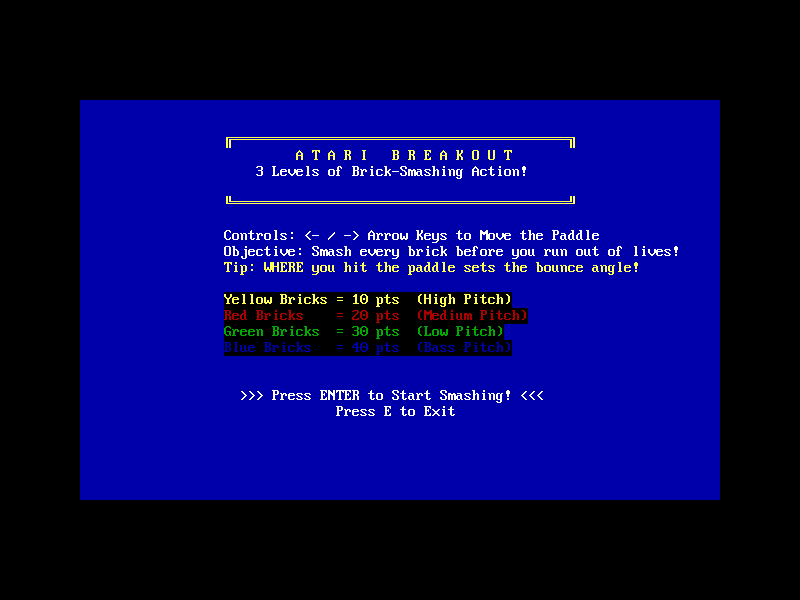
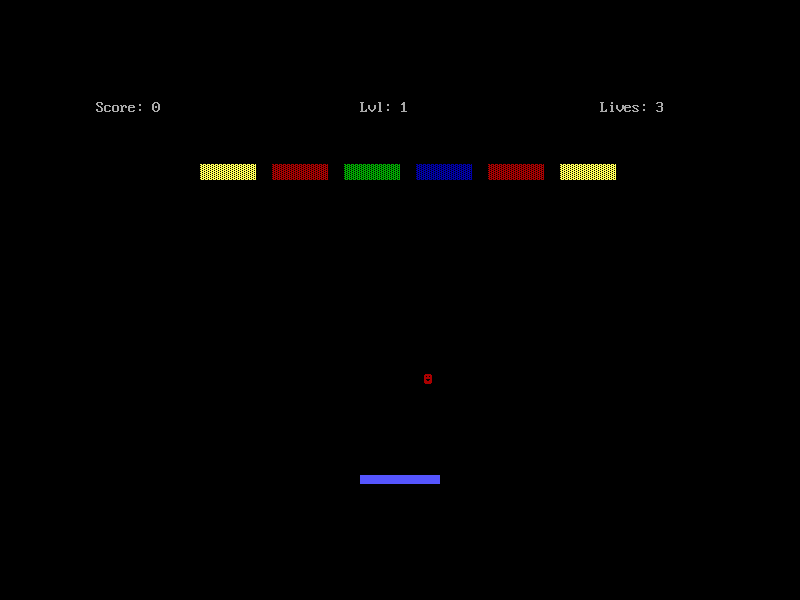
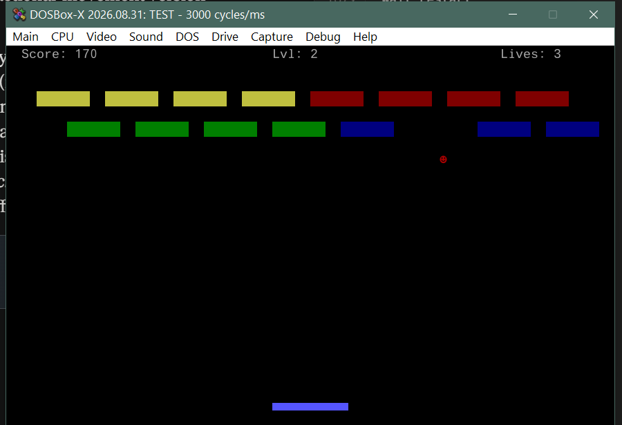
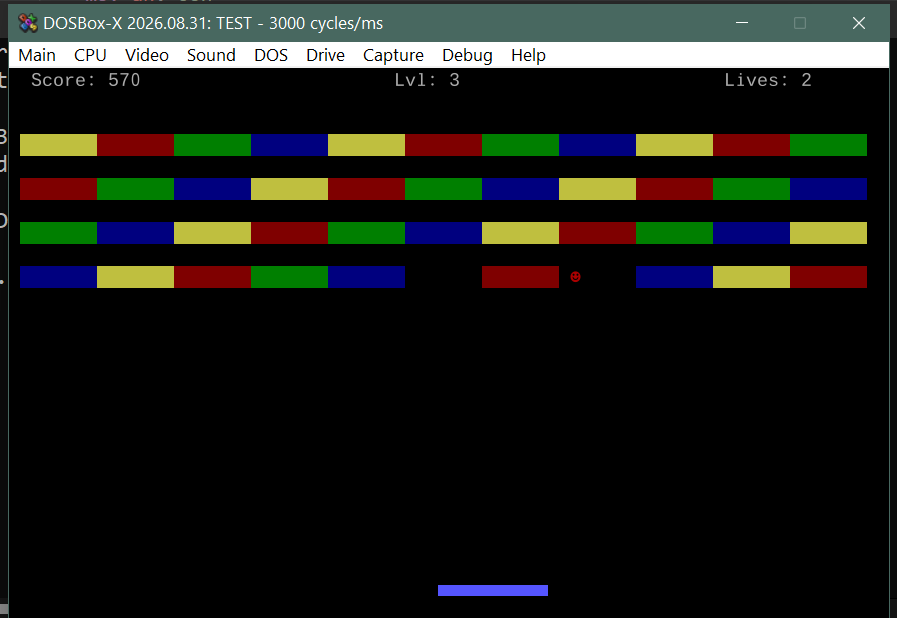
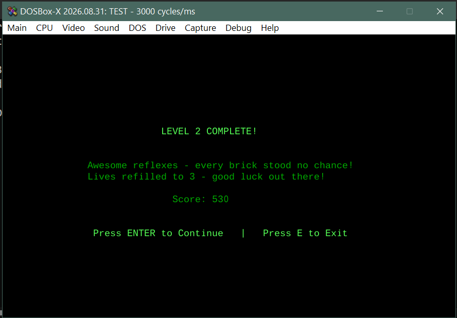
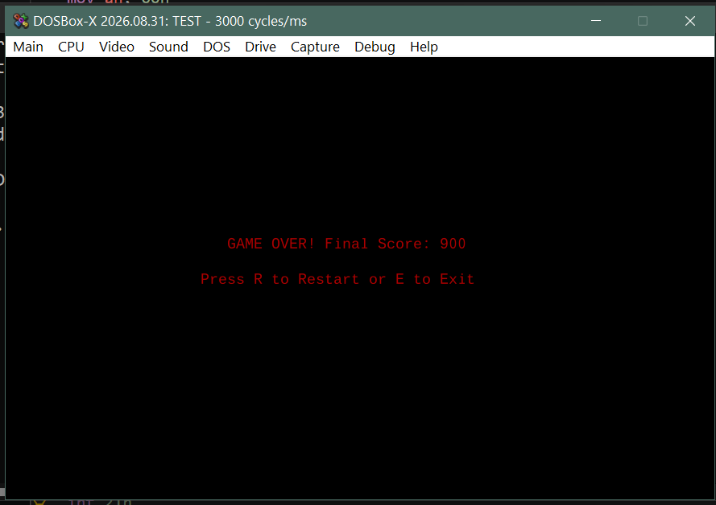

# ATTARI Breakout

### A Classic Breakout-Style Game in 16-bit x86 Assembly


**ATTARI Breakout** is a classic brick-breaking arcade game developed in NASM x86 Assembly as a Computer Organization and Assembly Language (COAL) lab project.

The game runs in DOS text mode and uses BIOS and DOS interrupts to handle keyboard input, screen output, cursor positioning, and other low-level operations. Players control a paddle to bounce a ball toward colored bricks, earn points, and progress through three levels.

The project demonstrates fundamental assembly-language concepts through an interactive game, including register operations, memory variables, conditional branching, loops, procedures, hardware interaction, and game-state management.


---

## Table of Contents

- [Overview](#overview)
- [Features](#features)
- [Gameplay](#gameplay)
- [Scoring System](#scoring-system)
- [Controls](#controls)
- [Technologies and Concepts](#technologies-and-concepts)
- [Requirements](#requirements)
- [Installation and Setup](#installation-and-setup)
  - [Windows](#windows)
  - [Linux](#linux)
- [Building the Project](#building-the-project)
- [Running the Game](#running-the-game)
- [Expected Outcomes](#expected-outcomes)
- [Screenshots](#screenshots)
- [Project Structure](#project-structure)
- [Technical Notes](#technical-notes)
- [Troubleshooting](#troubleshooting)
- [Limitations](#limitations)
- [Future Improvements](#future-improvements)
- [Author](#author)
- [License](#license)

---

## Overview

ATTARI Breakout is a single-file, ~1,100-line NASM assembly program that reimplements the classic Breakout/Arkanoid formula for 16-bit DOS. The ball, paddle, and bricks are all rendered as colored characters in 80x25 VGA text mode, moved and collision-checked on a character-grid basis every frame.

The whole game — video mode setup, input handling, physics, collision detection, scoring, sound, and three full levels — is written directly against BIOS interrupts (`INT 10h`, `INT 16h`, `INT 21h`) and the 8253/8254 Programmable Interval Timer (for PC speaker tones), with no external libraries or high-level runtime of any kind.

## Features

- **Three distinct levels** of increasing difficulty: a single rainbow row, a two-row split pattern, and a dense 4-row, 44-brick rainbow-cycling grid.
- **Position-based paddle physics** — a 5-zone bounce system where where you hit the paddle (dead center, slightly off, or the far edge) changes the ball's rebound angle, with an anti-lock rule that guarantees the ball can never get stuck oscillating in a single column forever.
- **Color-coded scoring**, with each brick color also mapped to a distinct PC-speaker pitch.
- **Lives system** (3 lives per level, refilled on level clear) with a proper game-over state.
- **A colorful, bordered welcome screen** with a scoring legend that uses the *exact same color attributes* as the in-game bricks.
- **Distinct level-complete (dark green) and game-over (dark red/maroon) screens**, each with its own messaging and a clean restart flow.
- **In-place restart** (`R`) without leaving the program, and a clean exit (`E`) from any screen.

## Gameplay

1. The game opens on a welcome screen with controls, objective, and a scoring legend.
2. Press **Enter** to start. The paddle and ball reset, and Level 1's bricks are drawn.
3. Move the paddle with the arrow keys to keep the ball in play and break every brick.
4. Clearing every brick in a level shows a level-complete screen with your running score, then advances to the next level on **Enter**.
5. Losing all 3 lives ends the game with a final score and the option to restart.
6. Clearing all 3 levels shows a victory screen.

## Scoring System

| Brick Color | Points | Speaker Pitch |
|---|---|---|
| Yellow | 10 | High |
| Red | 20 | Medium |
| Green | 30 | Low |
| Blue | 40 | Bass (lowest) |

## Controls

| Key | Action |
|---|---|
| `Left Arrow` | Move paddle left |
| `Right Arrow` | Move paddle right |
| `Enter` | Start game / advance to next level |
| `R` | Restart (from game-over or win screen) |
| `E` | Exit the program (from any screen) |

## Technologies and Concepts

- **NASM** (Netwide Assembler) x86 syntax
- **16-bit real mode**, `.COM` executable format (`org 100h`)
- **BIOS video services** (`INT 10h`) for video mode setup, cursor control, and direct character/attribute writes to VGA text memory
- **BIOS keyboard services** (`INT 16h`) for both blocking and non-blocking key reads, including extended scan codes for the arrow keys
- **DOS services** (`INT 21h`) for string output and program termination
- **8253/8254 PIT programming** (ports `42h`/`43h`) combined with the PC speaker gate (port `61h`) for tone generation
- **VGA text-mode attribute bytes** (4-bit foreground / 3-bit background / blink) used both for brick color-coding and for the screens' color themes
- **Character-grid collision detection** — the ball, paddle, and bricks all occupy discrete screen cells; collisions are resolved by reading back character/attribute data directly from video memory (`INT 10h, AH=08h`)

## Requirements

Because this is a 16-bit DOS program, it cannot run natively on modern 64-bit Windows or Linux — it needs to be built with an assembler and run inside a DOS environment (an emulator like DOSBox is by far the easiest route on any modern OS).

- **NASM** (2.x or later)
- **DOSBox** (or another DOS emulator / a real DOS machine)

## Installation and Setup

### Windows

1. **Install NASM**
   - Download the Windows installer from [nasm.us](https://www.nasm.us/) and run it, **or**
   - If you have [Chocolatey](https://chocolatey.org/): `choco install nasm`
   - Verify with: `nasm -v`
2. **Install DOSBox**
   - Download from [dosbox.com](https://www.dosbox.com/), **or**
   - `choco install dosbox` / `winget install dosbox`
3. Add both to your `PATH` if the installer doesn't do it automatically, so they can be run from any Command Prompt / PowerShell window.

### Linux

Most distributions package both tools directly:

```bash
# Debian / Ubuntu
sudo apt update
sudo apt install nasm dosbox

# Fedora
sudo dnf install nasm dosbox

# Arch
sudo pacman -S nasm dosbox
```

## Building the Project

From the project directory, assemble the source into a flat-binary DOS `.COM` file:

```bash
nasm -f bin breakout.asm -o BREAKOUT.COM
```

This should complete with **no errors or warnings**. The output is a small (~2-3 KB) `.COM` file.

## Running the Game

**Using DOSBox (recommended, works identically on Windows and Linux):**

```bash
dosbox -c "mount c ." -c "c:" -c "BREAKOUT.COM"
```

Or launch DOSBox normally, then at the `Z:\>` prompt:

```
mount c .
c:
BREAKOUT.COM
```

**On real DOS / FreeDOS:** just copy `BREAKOUT.COM` onto the machine (or a bootable floppy/USB image) and run `BREAKOUT` from the DOS prompt — no emulator needed.

## Expected Outcomes

- Launching the game shows the bordered, color-legend welcome screen (see screenshots below).
- Pressing Enter drops you into Level 1 with the HUD (score, level, lives) across the top and the paddle/ball/bricks rendered below.
- Successfully clearing all bricks in a level shows a dark-green level-complete screen with a running score and a prompt to continue.
- Running out of lives shows a dark-red/maroon "GAME OVER" screen with your final score and a restart prompt.
- Clearing all 3 levels shows a victory screen.

## Screenshots

Screenshots of the running game should be added here to demonstrate the user interface and gameplay.


### 1. Welcome Screen

Displays the game title, controls, scoring rules, and start instructions.



### 2. Level 1 — Rainbow Row

Shows the initial gameplay screen and the first brick arrangement.



### 3. Level 2 — Split Rows

Shows the second level and its brick layout.



### 4. Level 3 — Full Grid

Shows the final level's brick arrangement.



### 5. Victory Screen

Shows the message displayed after all three levels are completed.



### 6. Game Over Screen

Shows the final score after all lives have been lost.




## Project Structure

```text
ATTARI-Breakout/
│
├── breakout.asm
├── README.md
├── LICENSE
├── .gitignore
│
└── screenshots/
    ├── welcome-screen.png
    ├── level-1.png
    ├── level-2.png
    ├── level-3.png
    ├── victory.png
    └── game-over.png
```

`BREAKOUT.COM` (the assembled binary) is not committed — build it yourself with the command in [Building the Project](#building-the-project). If you'd rather keep a prebuilt binary in the repo for convenience, that's a reasonable call too; just be aware it'll go stale if the source changes and isn't rebuilt.

## Technical Notes

A few design decisions worth knowing if you're reading or extending the source:

- **Why the brick layouts differ between levels:** Levels 1 and 2 use a classic sparse layout with gaps between bricks. Level 3 uses a *zero-gap, full-width, color-cycling* layout instead — every brick touches its neighbor, and adjacent bricks always differ in color. This matters because the brick-clearing routine decides where one brick ends and the next begins by checking for a *color change*, not just empty space — so a solid single-color zero-gap row would be destroyed in a single hit instead of brick-by-brick. Cycling through all 4 colors per row keeps every brick independently destroyable while still guaranteeing full-width coverage (no gap the ball can sail through untouched).
- **The anti-lock paddle rule:** hitting dead-center sends the ball straight up, and a straight shot always returns to the exact same paddle column — which means a player who naturally centers their paddle under a predictable ball could get it stuck oscillating in one column forever. After 2 consecutive dead-center hits, the 3rd is automatically redirected into a slight angle, guaranteeing the ball can never get permanently trapped while still preserving genuine straight shots most of the time.
- **Bounce angles are approximate, not literal degrees.** The ball moves exactly one row per frame with a whole-number column step. That makes 90° (straight), 45°, and ~27° the only *exactly* representable angles on this grid — true arbitrary-degree angles would need fractional sub-column position tracking (see [Future Improvements](#future-improvements)).
- **Dark UI themes use black backgrounds, not dark-colored ones.** Standard VGA text mode only offers 8 background colors with no "bright" variant for backgrounds (only foreground text can be intensity-boosted) — so there's no true "dark green background." The level-complete and game-over screens instead use a black background with dark green / dark red foreground text to achieve the moodier look.
- **Scoring colors double as a legend.** The welcome screen's color-coded point values use the *exact same attribute bytes* as the real bricks, so what you see in the legend is pixel-identical to what you'll see in-game.

## Troubleshooting

**`nasm: command not found` / `'nasm' is not recognized`**
NASM isn't installed or isn't on your `PATH`. Re-check the [Installation](#installation-and-setup) steps and confirm `nasm -v` works in a fresh terminal.

**Assembly fails with errors**
Make sure you're using the `-f bin` output format (not `-f elf` or `-f win32`) — this is a flat DOS `.COM` binary, not an object file for a linker.

**DOSBox opens but the screen is black / nothing happens**
Give it a second — DOSBox needs a moment to initialize its video output. If it persists, confirm the `mount` path actually points to the folder containing `BREAKOUT.COM`.

**No sound in DOSBox**
PC speaker emulation depends on your DOSBox build and host audio setup. Check `dosbox.conf` for `pcspeaker=true` (the default in most builds). Sound is cosmetic — the game is fully playable without it.

**Keyboard input doesn't register**
Click inside the DOSBox window first to make sure it has keyboard focus — the host OS won't forward key events to a window that isn't focused.

**The game runs extremely fast or extremely slow**
This game paces itself with manual CPU busy-wait loops rather than a hardware timer, so its speed is tied directly to DOSBox's configured CPU cycles. Adjust cycles in DOSBox with `Ctrl+F11` (decrease) / `Ctrl+F12` (increase), or set a fixed `cycles=` value in `dosbox.conf`.

## Limitations

- **Timing is CPU-cycle-based, not wall-clock-based.** Frame pacing and sound duration use busy-wait loops rather than the BIOS timer tick (`INT 1Ah`), so actual game speed varies with host/emulator performance.
- **Bounce angles are discretized**, not continuous — see [Technical Notes](#technical-notes).
- **No persistent high-score or save system** — scores reset when the program exits.
- **Single source file.** At ~1,100 lines this is still manageable, but it isn't split into modules/includes.
- **No automated tests.** Correctness has been verified through assembly, static tracing, and manual/scripted gameplay capture — there's no regression test suite.
- **Text-mode graphics only.** Bricks, paddle, and ball are character-cell blocks, not pixel-level sprites.

## Future Improvements

- Fractional sub-column ball-position tracking for true continuous-angle physics instead of the current 5-step discrete system.
- A persistent high-score table using DOS file I/O (`INT 21h` file functions).
- Additional levels, and/or a simple level-data format so layouts don't have to be hand-assembled.
- Power-ups (multi-ball, paddle size change, etc.).
- Interrupt-driven timing (`INT 1Ah` / a custom `INT 08h` handler) instead of busy-wait delays, for consistent speed across any hardware.
- Optional VGA 13h (320x200 pixel mode) rendering for smoother, non-grid-locked visuals.

## Author

**Ali Amir**

Computer Science, FAST-NUCES Faisalabad
Computer Organization and Assembly Language (COAL) Lab Project

## License

This project is licensed under the MIT License — see [LICENSE](LICENSE) for the full text. Feel free to swap in a different license before publishing if your coursework or institution requires one.

## Acknowledgments

- [NASM — The Netwide Assembler](https://www.nasm.us/)
- [DOSBox](https://www.dosbox.com/)
- The classic Breakout arcade game concept.
- Computer Organization and Assembly Language coursework.
